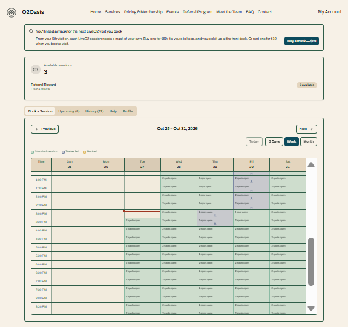
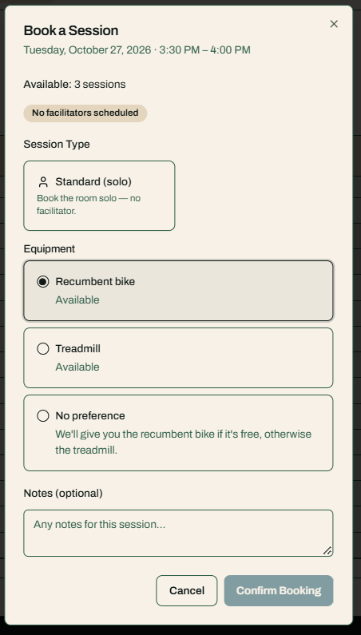
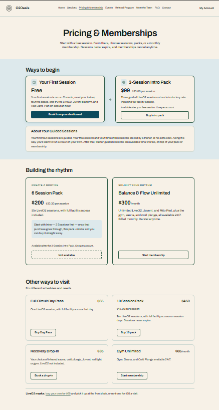
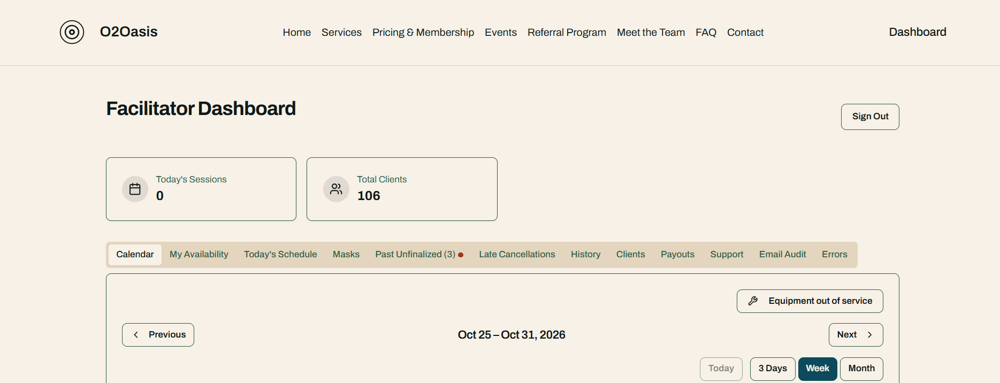
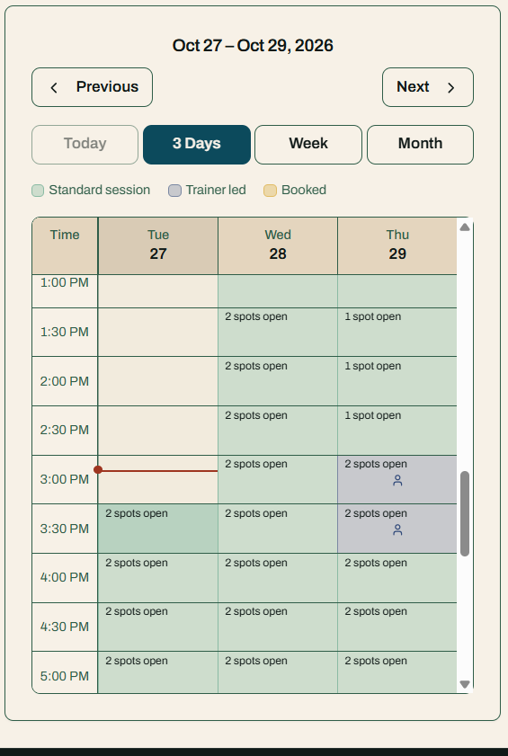
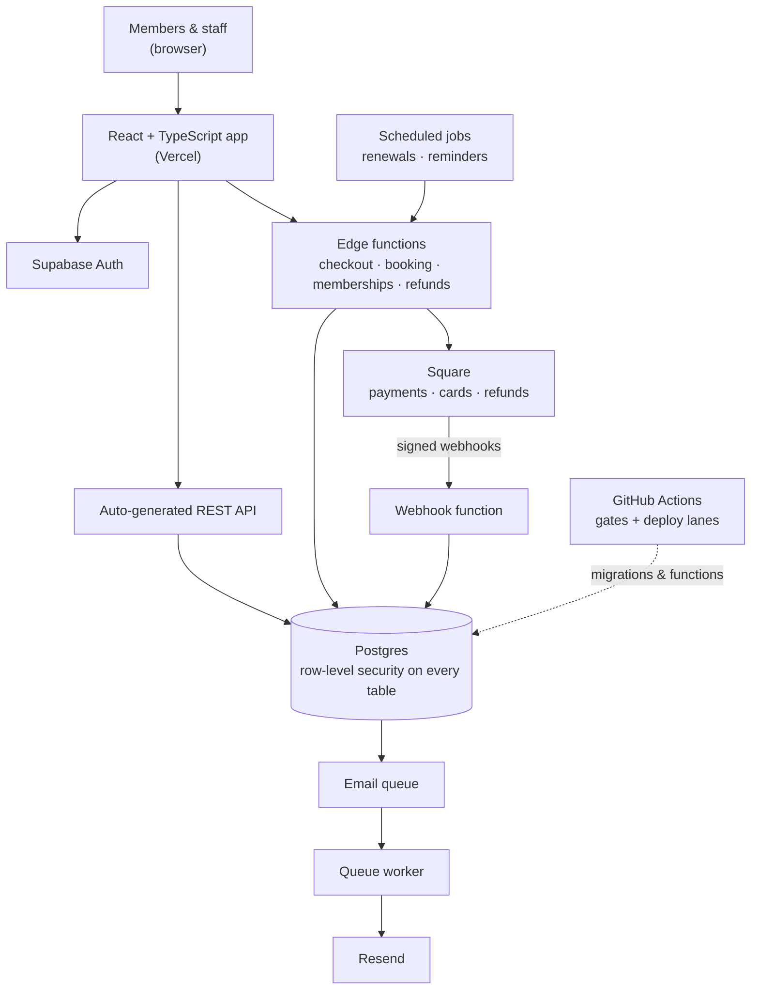
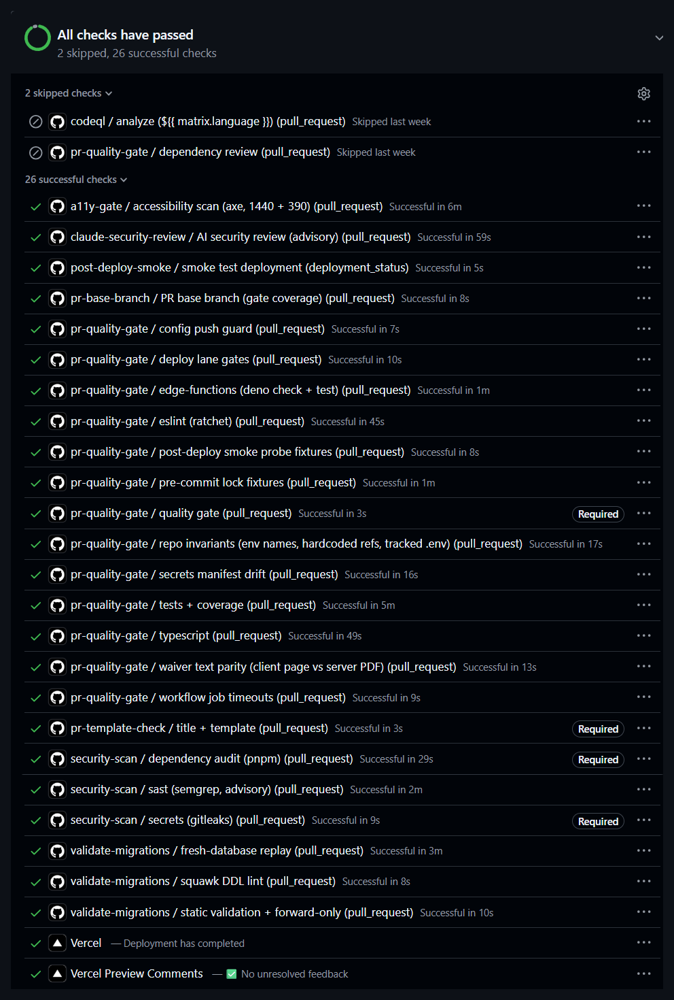

# Booking & payments platform — case study

How I designed, built and run a live booking, membership and payments platform for a gym, and
what the code that keeps members' money and data safe looks like.

The platform's codebase is private. It was built through 2026, and the cutover to it went live in
September 2026. This repo, put together in October 2026, has the write-up plus ten excerpts taken
from production code. Comments are lightly edited, and each excerpt says what changed.

**Joree Weatherly** · Technical Product & Solutions · [joreeweatherly.com](https://joreeweatherly.com) ·
[LinkedIn](https://www.linkedin.com/in/joreeweatherly)

---

## The problem

O2Oasis, a gym, ran member booking, memberships and payments on an app built with a no-code tool.
The business had outgrown it: there was no staging environment, no review step before changes went
live, and no safe way to test against real data. Members were booking and paying every day, so
the replacement had to go in without interrupting them.

## My role

Sole technical owner: requirements with the owner, architecture, build, data migration, release
management and day-to-day support. I write the tickets, direct AI coding agents that do much of the
implementation, review their work, and merge every change by hand.

## What it looks like

**Members book their own sessions.** The weekly calendar shows open spots, with trainer-led
sessions marked.

| Booking a session | Pricing and memberships |
| -- | -- |
|  |  |
| The member picks a session type and a piece of equipment. Credits are checked before the booking is confirmed. | Intro offer, session packs and monthly memberships, all paid through Square. |

**Staff run the day from their own dashboard:** calendar, availability, the day's schedule,
late cancellations, payouts, support and an email audit, all in one place.

| On a phone |
| -- |
|  |
| Phones default to a three-day view, so the calendar stays readable without sideways scrolling. |

*Screenshots are from the live app. Member and staff names, email addresses and a staff
member's name in the calendar key were removed before publishing.*

## Architecture

| Layer | Choice | Why |
| -- | -- | -- |
| App | React, TypeScript, Vite, Tailwind, shadcn/ui | Typed end to end, fast to iterate, a large hiring pool after me |
| Data and auth | Supabase (Postgres, Auth, edge functions) | Access rules live in the database, so every client path is covered, not just the screens I remember |
| Payments | Square | The business already ran its front desk on Square, so card-on-file, refunds and reporting stay in one place |
| Email | Resend, behind a Postgres queue | Sending survives provider rate limits and outages without losing a confirmation |
| Hosting and CI | Vercel, GitHub Actions | Preview per PR, and promotion from `dev` → `staging` → `main` |
| Tickets | Linear | One ticket per PR, so every change has a written reason |

## Follow one booking

A member books a $40 trainer-led session. This is the path it takes through production, read from
the code. At each step, the question is what happens if it runs twice, or stops halfway.

1. **The member taps Book.** The booking dialog calls the `book-trainer-session` edge function with
   an idempotency key the browser generated. A retry after a declined card reuses that key. Only an
   attempt that ended in a refund gets a new one.
2. **The attempt is claimed before anything else.** A database function claims the attempt for that
   key. A second tap while the first is running gets "booking in progress". A repeat of a finished
   attempt gets the first answer back. If the claim can't be read, the function refuses rather than
   charge.
3. **Every check runs before any money moves.** It checks the liability waiver, the member's
   fee-free sessions and weekly limits, and whether the slot is free. A refusal releases the claim,
   and nothing is charged.
4. **Square takes the payment.** The function calls Square's payments API with a key built from
   the member, the slot and the amount ([03](excerpts/03-idempotency-keys.ts)). On a timeout, the
   claim stays retryable, and the retry sends the same key, so Square returns the first payment
   instead of charging again.
5. **The booking is named before it is written.** The claim records the planned booking id and the
   payment id first. At no point has money moved without the claim naming the booking it paid for.
6. **The booking is inserted, and the database has the last word.** An exclusion constraint makes
   an overlapping booking impossible ([05](excerpts/05-booking-overlap-constraints.sql)). If the
   insert fails, the attempt is marked spent, then the member is refunded with its own fixed key,
   so the refund can't be issued twice.
7. **The charge is recorded, then the attempt is marked done.** The Square payment id and the
   member's key are both unique columns. If this write fails, the booking is cancelled first, then
   the charge is refunded with its own fixed key. Errors are scrubbed before they are stored
   ([08](excerpts/08-error-scrubbing.ts)).
8. **The member sees "Session booked — $40.00 charged",** and the app asks for the confirmation
   email.
9. **The confirmation goes to the member, and a notification to the trainer.** Each email's
   idempotency key comes from the booking, and both are written to a send log and placed on a
   Postgres queue. A suppressed address is checked first, and that check fails closed.
10. **A worker sends it through Resend.** A scheduled worker drains the queue every few seconds and
    passes Resend an idempotency key. Retries are counted from real send failures, and after five
    a message goes to a dead-letter queue with its reason ([07](excerpts/07-email-retry-budget.ts)).
    Before sending, it checks whether that message was already sent, and if the check itself fails,
    it does not send.

**Where the Square webhook fits.** It isn't on this path, because the payment answer comes back
synchronously in step 4. The webhook's job is the money coming *back*. When a refund is issued,
including one made by hand at the front desk, Square sends a signed event
([01](excerpts/01-webhook-signature.ts)). The webhook matches it to what was bought (a membership,
a pack, a day pass, a drop-in, a mask purchase or rental) and reverses what the refund paid for.
Refunds arrive more than once, so recording them is idempotent
([02](excerpts/02-webhook-duplicate-delivery.ts)).

## Key decisions

- **Moved off the no-code tool into a codebase the business owns.** Every schema change is a
  reviewed migration, and every change runs locally against a local database before it goes
  anywhere near members.
- **Migrated members without a forced password reset.** Accounts moved over with their credentials
  intact, so no one had to reset a password.
- **The database is the last line of defence.** Overlapping bookings are impossible at the database
  level ([05](excerpts/05-booking-overlap-constraints.sql)), and members can only create bookings in
  the shape a member is allowed to ([06](excerpts/06-member-insert-policy.sql)), whatever the browser
  sends.
- **Every money path is safe to retry.** Payment calls use deterministic idempotency keys
  ([03](excerpts/03-idempotency-keys.ts)). Webhooks are verified ([01](excerpts/01-webhook-signature.ts))
  and safe to deliver twice ([02](excerpts/02-webhook-duplicate-delivery.ts)). Renewals defer rather
  than guess when they can't confirm what an earlier run did
  ([04](excerpts/04-renewal-retry-safety.ts)).
- **Concurrency is designed for, not hoped away.** When two admins settle the same refund, one
  wins and the other is told so ([09](excerpts/09-manual-refund-compare-and-swap.ts)).
- **Member data stays out of logs.** Error reports are scrubbed on the server before they are
  stored ([08](excerpts/08-error-scrubbing.ts)), and ad platforms receive conversions with no
  customer details.
- **Checks fail closed.** Several CI checks turned out to report success while checking nothing. Each
  one now refuses to pass when it could not run, and each was shown failing on purpose before it was
  trusted ([10](excerpts/10-fail-closed-deploy-gate.sh)).
- **Split the platform when the business split.** When the fitness center became its own LLC, I
  separated it from the wellness center it had shared one app with, in a week, and staged the
  payment-account switch behind a written runbook. See [Client delivery](#client-delivery).

## Client delivery

### Splitting the platform when the business split

**Before.** One app, one database and one domain served two businesses: the fitness center, and
Hidden Springs Wellness Center's practitioner directory, contact form and room rentals. Both ran
on one Square merchant account and sent email from one domain.

**The trigger.** On 4 September 2026, the day after the platform went live on its new hosting, the
owner decided to form a new LLC for the fitness center: O2Oasis.

**What I did.**

- **Ran it as three tracks with their own tickets:** the domain move, the wellness center's
  marketing site, and the Square and LLC separation. Each could ship or wait without holding up
  the others.
- **Gave the wellness center only what it needed.** Its site moved to its own repo, its own
  hosting project, and a small backend of its own (3 tables and 1 function) with its own migration
  pipeline. It did not get a copy of the booking platform.
- **Kept every member exactly where they were.** All 74 accounts stayed on the O2Oasis platform.
  The new domain was added to the sign-in redirect allow-list before any traffic moved. Links in
  emails already sent kept working through a temporary redirect, and the old site got 12 "we've
  moved" pages pointing members to the new one.
- **Moved the wellness center's enquiries with a script, not by hand.** It runs export, preflight,
  an import in a single transaction, and a row-by-row checksum comparison. It prints counts only,
  never personal data. Two rehearsals on local copies verified 19 of 19 and 13 of 13 rows. They
  also caught three bugs before production: `pg_restore --table` reporting success after moving
  0 rows, a timezone setting corrupting the row counts, and a temporary file of personal data
  left on disk.
- **Updated the legal copy.** The liability waiver and the privacy policy now name O2Oasis LLC.
- **Removed the old brand from the app,** with redirects for retired pages. Leftover wellness
  center code had been misleading the AI agents: a stale draft policy claimed the two businesses
  shared a database.

**What's deliberately still open.** Payments still run on the original Square merchant account.
Saved cards belong to one merchant account, so switching to the new LLC's account means every
member on a recurring membership re-enters their card, and the card-update flow needs a change to
support that. The platform keeps the existing account until Square finishes underwriting the new
LLC. The switch, including its rollback, is written as a runbook ready to execute.

**Outcome.** The new domain and the separate marketing site went to production on 11 September,
a week after the decision, with no member losing access.

## Results

- 477 merged pull requests on the platform repo from July to October 2026, 418 of them tied to
  their own ticket
- Members moved to the new platform with no service interruption
- 12 production releases since go-live, each one a wave promoted through `dev` → staging QA →
  production, with every merge done by hand
- Platform split across two businesses in a week, with the payment-account switch staged behind
  a runbook

## The excerpts

| # | Excerpt | Pattern |
| -- | -- | -- |
| 01 | [Webhook signature](excerpts/01-webhook-signature.ts) | Verify the raw body with a constant-time HMAC check, and fail closed on every missing piece |
| 02 | [Duplicate webhook delivery](excerpts/02-webhook-duplicate-delivery.ts) | A unique constraint makes redelivery a no-op; side effects first, record second |
| 03 | [Idempotency keys](excerpts/03-idempotency-keys.ts) | Deterministic, collision-safe keys within a payment API's 45-character limit |
| 04 | [Renewal retry safety](excerpts/04-renewal-retry-safety.ts) | A failed read defers the charge; it is never treated as "nothing happened" |
| 05 | [No double-booking](excerpts/05-booking-overlap-constraints.sql) | Postgres exclusion constraints on overlapping time ranges |
| 06 | [Member insert policy](excerpts/06-member-insert-policy.sql) | A row-level security policy plus a postflight block that fails the deploy if it drifts |
| 07 | [Email retry budget](excerpts/07-email-retry-budget.ts) | Count real send failures, not queue reads; dead-letter with a reason |
| 08 | [Error scrubbing](excerpts/08-error-scrubbing.ts) | Redact by pattern, drop personal keys, fingerprint the scrubbed message |
| 09 | [Refund compare-and-swap](excerpts/09-manual-refund-compare-and-swap.ts) | Audit before mutating; three outcomes the admin can tell apart |
| 10 | [Fail-closed deploy gate](excerpts/10-fail-closed-deploy-gate.sh) | A gate that would check nothing refuses to pass |

## How the work gets done

Every ticket goes through five steps: check the ticket's claims against the code; design options,
have a dissenting reviewer attack the chosen one, then build; prove it in the running app; trace
what it might break and test each item; review, open the PR and stop. The commands, agents and CI
templates are public in [agentic-workflow](https://github.com/J0r33/agentic-workflow).

Every PR then has to pass 26 automated checks before it can merge: type checks, linting, tests and
coverage, a replay of every database migration on a fresh database, migration linting, secret
scanning, dependency audits, static analysis, accessibility scans at desktop and phone widths, and
checks on the PR's own template and blast-radius section. Four of them are required by branch
protection, and the merge itself is still done by hand.

## License

Licensed under [Apache-2.0](LICENSE). If you reuse these excerpts, please keep the
[NOTICE](NOTICE).
